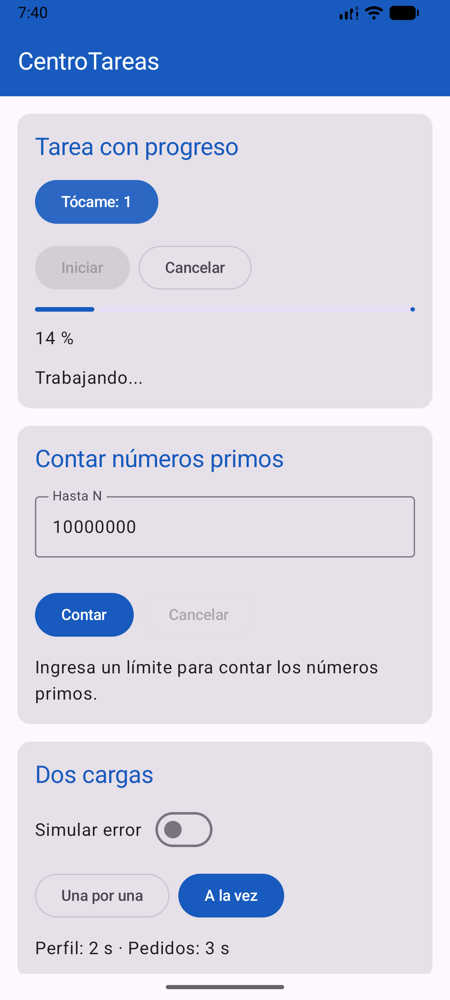
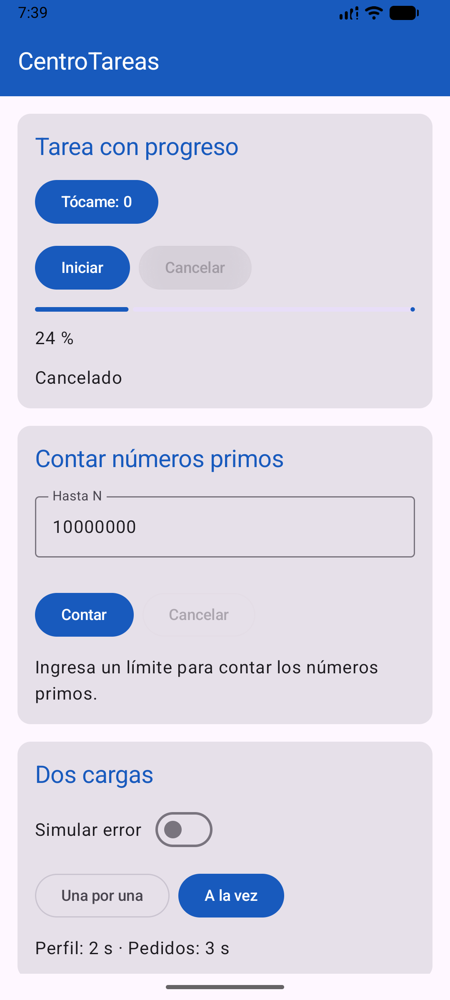
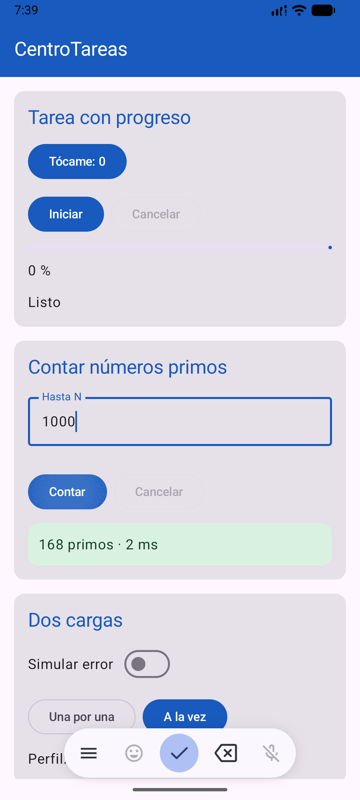
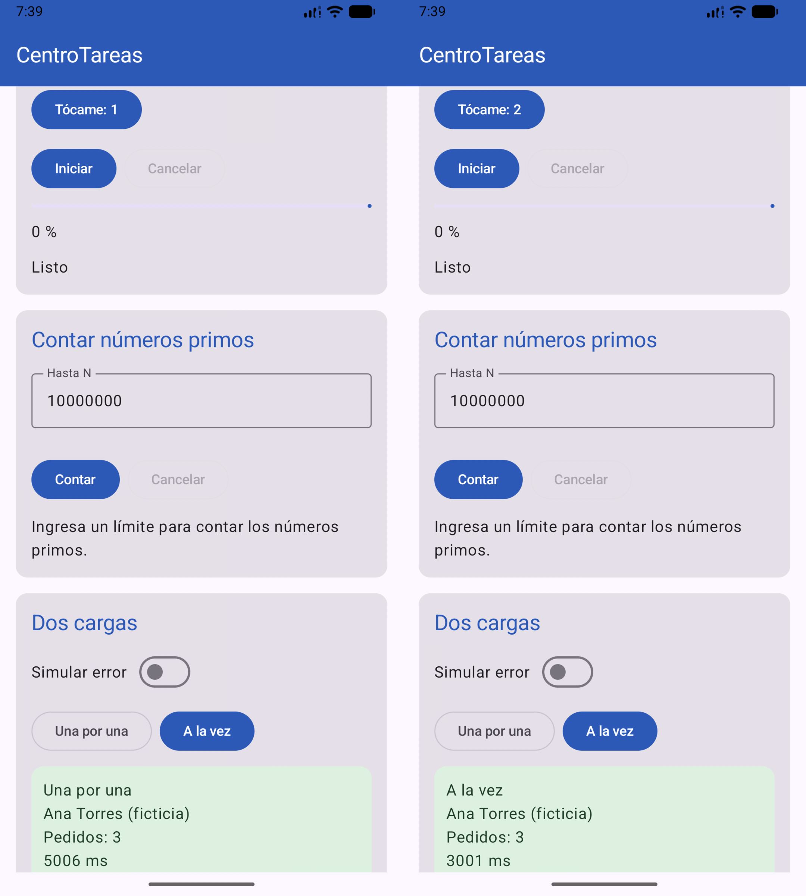
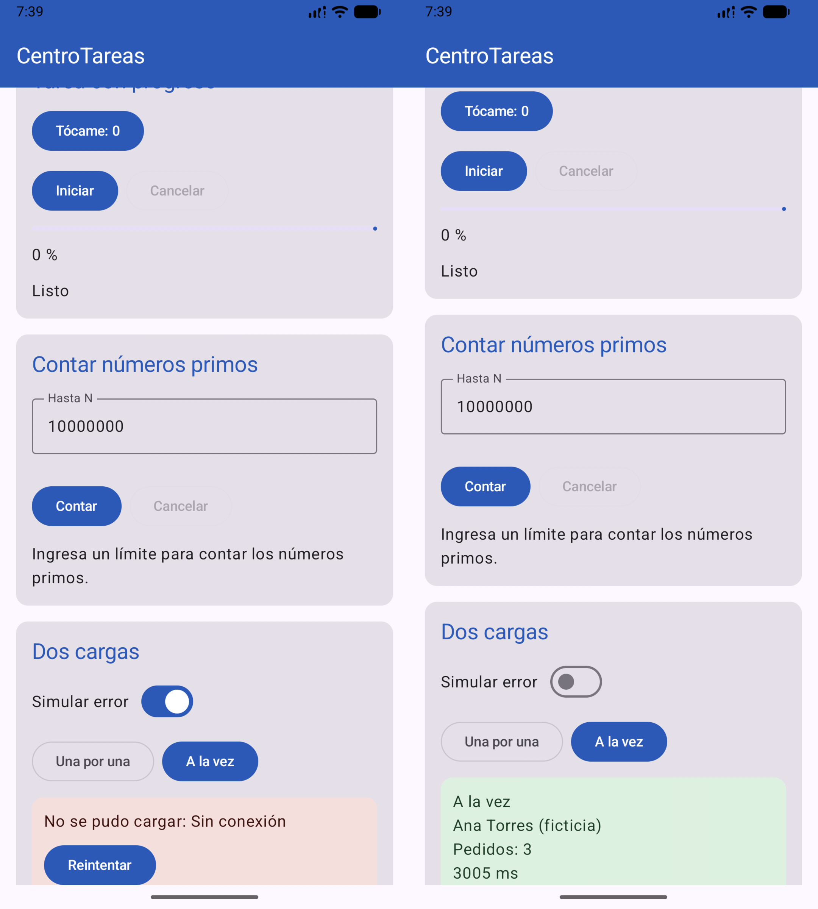

# CentroTareas

Aplicación Android del laboratorio GLAB-S14-JLEONS-2026 con Kotlin,
Jetpack Compose, Material 3 y arquitectura MVVM + Repository.

Demuestra cómo mantener la interfaz disponible mientras se ejecutan tareas
prolongadas: progreso cancelable, cálculo de números primos y dos cargas
simuladas, con ejecución secuencial/paralela, errores y reintento. Todos los datos
son ficticios; no se realizan peticiones de red ni se requieren permisos de internet.

El paquete `com.clemente.centrotareas` se utiliza por indicación del profesor.
Se conserva el primer commit del alumno sin modificar su mensaje ni su historial.
La estructura base que faltaba se incorpora junto con el Paso 1, por acuerdo con
el alumno; no se importa otro proyecto. La Fase 1 permanece en `main` y las
mejoras de la Fase 2 se implementan exclusivamente en `mejora-ia`.

## Observación del Paso 1

La demostración temporal asigna `Trabajando...`, ejecuta `Thread.sleep(4000)`
en el hilo principal y asigna `Terminó`. Durante esos cuatro segundos la pantalla
no puede dibujar nuevos fotogramas ni atender los toques del contador.
Aunque el estado intermedio sí se asigna, `Trabajando...` no llega a dibujarse:
cuando el hilo vuelve a procesar la interfaz, el mensaje ya es `Terminó`.

Una espera de diez segundos podría provocar un diálogo de aplicación que no
responde (ANR), dependiendo de los eventos pendientes y de las condiciones del
sistema. No se ha realizado esa prueba de diez segundos.

La espera bloqueante es exclusiva de este paso y se elimina en el siguiente.

La prueba instrumentada del commit `f44533e` verificó que el hilo principal no
atendía un evento encolado durante la espera y que terminaba después de al menos
4000 ms. Ese código se conserva únicamente en el historial, no en la aplicación final.

## Tecnologías y ejecución

- Kotlin, Jetpack Compose y Material 3; sin layouts XML.
- ViewModel, `viewModelScope`, `StateFlow` y corrutinas.
- `Dispatchers.Default` para primos y la tarea de progreso; `Dispatchers.IO`
  para las cargas simuladas. En Fase 2, el Repository emite el progreso con
  `Flow` y `flowOn(Default)`; el ViewModel lo recolecta y publica en `Main`.
- MVVM con inyección manual de la interfaz Repository mediante una Factory.
- Gradle Kotlin DSL, catálogo de versiones, Git y GitHub.
- JUnit y pruebas instrumentadas de Compose.

Configuración conservada del proyecto: AGP 9.4.1, Gradle 9.6.0, JDK 25,
SDK de compilación/objetivo 37 y Android mínimo API 24. El wrapper selecciona
JDK 25 mediante la configuración de la JVM del daemon. Configura la ruta de tu
SDK en `local.properties`, que no se versiona, y abre el proyecto en Android Studio.
Ejecuta la configuración `app` en un dispositivo o emulador compatible.

Desde la raíz del repositorio:

```sh
./gradlew :app:assembleDebug :app:testDebugUnitTest :app:lintDebug
# Con un emulador o dispositivo conectado:
./gradlew :app:connectedDebugAndroidTest
```

El límite inicial de primos es 10 000 000: en el emulador de validación,
500 000 tardó 271 ms y 10 000 000 tardó 2061 ms. Se ajustó para que se perciba
el cálculo, como indica la guía. Puede cambiarse en el campo numérico; la duración
depende del dispositivo. No se añadieron esperas artificiales al algoritmo.

## Árbol de paquetes

Raíz del código: `app/src/main/java/com/clemente/centrotareas/`.

```text
com.clemente.centrotareas/
├── MainActivity.kt
├── model/
│   └── Estados.kt
├── data/
│   ├── TareasRepository.kt
│   └── TareasRepositoryLocal.kt
├── viewmodel/
│   ├── TareasViewModel.kt
│   └── TareasViewModelFactory.kt
└── ui/
    ├── PantallaTareas.kt
    └── theme/
        ├── Color.kt
        ├── Theme.kt
        └── Type.kt
```

## Arquitectura MVVM + Repository

```text
MainActivity ── compone la pantalla e inyecta Repository mediante Factory
                               │
                               ▼
                  PantallaTareas (View)
                    │ eventos     ▲ estados: collectAsState()
                    ▼             │
                  TareasViewModel ── StateFlow de solo lectura
                    │ viewModelScope, Job, launch, async
                    ▼
               TareasRepository (interface)
                    ▲ implementa
                    │
               TareasRepositoryLocal
               ├── contarPrimos: Default + ensureActive
               └── cargas ficticias: IO + delay
```

La View solo dibuja estados y comunica eventos; no lanza corrutinas.
El ViewModel depende de la interfaz, no de su implementación ni de un Context.
El Repository no conoce los estados de pantalla y expone funciones suspend
seguras para llamarse desde el hilo principal. Los Jobs de progreso y primos
son independientes; sus botones evitan iniciar dos trabajos del mismo tipo.

## Cinco evidencias de ejecución

Capturas reales del emulador `Medium_Phone_API_37.0`, tomadas el 18 de noviembre
de 2026 mediante `UiAutomation.takeScreenshot()` durante pruebas instrumentadas.
La cuarta y quinta imagen colocan dos capturas lado a lado para mostrar la
comparación y la recuperación; no se alteraron los resultados. Las capturas
individuales originales también se incluyen en `docs/capturas/originales/`.

### 1. Tarea con progreso y contador activo



### 2. Tarea cancelada



### 3. Resultado de primos hasta 1000



### 4. Comparación: una por una frente a la vez



### 5. Error simulado y reintento exitoso



## Pruebas de aceptación

Verificadas en el emulador API 37 el 18 de noviembre de 2026:

| Verificación | Resultado |
| --- | --- |
| Tres tarjetas y contador | Correcto |
| Toques durante el progreso | El contador aumenta mientras muestra Trabajando... |
| Logcat HILO | main antes/después; DefaultDispatcher-worker dentro |
| Progreso | 0 % a 100 %, cien esperas de 40 ms; aproximadamente 4–5 s con instrumentación |
| Cancelación y reinicio | Progreso detenido; Cancelado; reinicio desde cero |
| Doble inicio | Botón deshabilitado y protección adicional en ViewModel |
| Primos N=100 / 1000 / 10000 | 25 / 168 / 1229 |
| Primos N=10000000 | 664579; medición inicial de 2061 ms |
| Primos con límite grande | Contador responde y cálculo cancelable |
| Una por una / A la vez | Aproximadamente 5000 / 3000 ms; perfil y tres pedidos correctos |
| Error en ambos modos | Sin cierre de la app; recuadro de error y Reintentar |
| Desactivar error y reintentar | Éxito mediante carga paralela |
| Recreación de Activity | Mismo ViewModel; progreso conservado y finalización al 100 % |
| Restricciones del código final | Sin GlobalScope, runBlocking ni Thread.sleep en app/src |

La batería Gradle de aceptación tiene diez pruebas instrumentadas y una prueba
unitaria de ejemplo: todas pasaron. Lint terminó sin errores y con trece
advertencias (recursos de plantilla sin uso, etiqueta redundante y avisos de
versiones disponibles, entre otras). No se actualizaron herramientas solo para
eliminar avisos. La recreación se probó con `ActivityScenario.recreate()`;
no se presenta como una prueba de muerte del proceso ni como un gesto físico de rotación.

Como comprobación adicional se reinstalaron ambos APK y se ejecutó directamente
`PantallaTareasTest` con el runner de Android: `OK (9 tests)` en 61,555 segundos.
Esta ejecución excluye la prueba de contexto de ejemplo y generó las capturas
publicadas: 5006 ms secuencial y 3001 ms paralelo. Su medición de primos hasta
10 000 000 fue de 2012 ms. También se verificó el arranque real de MainActivity
mediante ADB (`Status: ok`). No quedan capturas pendientes de proporcionar.

## Para pensar

### ¿Por qué no se veía Trabajando... en el Paso 1?

Asignar un estado no dibuja inmediatamente la pantalla. La recomposición, el
dibujo y los eventos necesitan que el hilo principal pueda ejecutarlos.
La espera bloqueante lo ocupaba cuatro segundos; cuando quedaba libre,
el estado ya había cambiado a Terminó.

### ¿Qué diferencia hay entre Thread.sleep y delay?

`Thread.sleep` bloquea el hilo que lo ejecuta, que no puede atender otro trabajo.
`delay` suspende la corrutina sin ocupar el hilo durante la espera y coopera con
la cancelación. Suspender no significa crear un hilo nuevo: el dispatcher
determina dónde se ejecuta el código cuando continúa.

### ¿Por qué Default para primos e IO para la red?

El cálculo de primos consume CPU; `Default` está pensado para trabajo
computacional. `IO` está pensado para operaciones bloqueantes de entrada/salida,
como ciertos accesos a red o disco. En este laboratorio no hay red real:
se usa `delay`, que no bloquea, por lo que IO no es necesario para esa espera,
pero identifica la naturaleza de la operación simulada. Una API suspend de red
que ya sea segura para Main no necesita envolverse en IO solo por ser de red.

### ¿Qué pasa si el usuario cierra la pantalla? ¿Qué hace viewModelScope?

Si la Activity finaliza definitivamente y su ViewModel se elimina, su
`viewModelScope` se cancela con sus corrutinas hijas. `delay` y `ensureActive`
permiten que el trabajo atienda esa cancelación. El bloque finally restablece
el estado de ejecución del progreso y las capturas de excepciones relanzan la
cancelación. Una recreación por configuración conserva el ViewModel, por lo que
la tarea sigue y la nueva UI recibe el último StateFlow. Ir al inicio del teléfono
no necesariamente destruye el ViewModel. La muerte del proceso no se resuelve
con viewModelScope: esta app no persiste trabajos ni resultados.

### ¿Por qué async tarda tres segundos y no cinco? ¿Y si una carga falla?

Ambas operaciones se inician antes de esperar sus resultados: las esperas de
dos y tres segundos se solapan y domina la más larga, con un pequeño coste de
planificación. Una por una sí suma ambas esperas. El beneficio aquí es
concurrencia; no exige que las esperas ocupen simultáneamente dos hilos.
Los async son hijos del mismo `coroutineScope`: si uno falla, el scope cancela
al otro si aún trabaja, espera su terminación y propaga la excepción. El catch
del ViewModel muestra Error; no publica un éxito parcial. En este ejemplo el
perfil suele haber terminado cuando los pedidos fallan. Reintentar inicia
otra carga paralela con el valor actual del interruptor.

## Control de versiones y alcance

La Fase 1 queda en `main`: se conserva intacto el primer commit creado por el alumno,
con su mensaje sin prefijo chore. La base faltante se incorporó al commit de
congelamiento, según el acuerdo explícito de continuar sin rehacer el primero.
Los commits restantes respetan el orden y los mensajes solicitados, cada uno
seguido de su push. La Fase 2 se agrega en `mejora-ia`, sin reescribir esos commits.

| N | Commit | Mensaje |
| --- | --- | --- |
| 1 | 95bf556 | inicializa proyecto CentroTareas desde cero |
| 2 | f44533e | feat(hilos): provoca el congelamiento con Thread.sleep en el hilo principal |
| 3 | 3e8b89e | fix(hilos): mueve la tarea larga a una corrutina con withContext |
| 4 | 4de2b6d | feat(progreso): agrega barra de progreso con StateFlow |
| 5 | a15521b | feat(cancelar): permite cancelar la tarea con Job |
| 6 | 46436f8 | feat(primos): cuenta primos en Dispatchers.Default con cancelacion |
| 7 | 4891784 | feat(carga): compara carga secuencial y en paralelo con async |
| 8 | cc81874 | feat(errores): maneja errores de carga y agrega reintento |
| 9 | Consultar git log | docs: agrega README con observaciones y capturas |

El hash del commit que contiene este README se consulta con `git log -1` para
evitar una autorreferencia imposible de fijar dentro de su propio contenido.

## Fase 2 — rama `mejora-ia`

### Progreso desde Repository

La tarea simulada ya no vive en el ViewModel: `progresoTarea()` devuelve un
`Flow<Float>` con 101 emisiones (0 y 100 avances), producido con
`flowOn(Dispatchers.Default)`. El ViewModel recolecta en `viewModelScope`,
actualiza el estado en Main y conserva la cancelación y el reinicio.

La asistencia utilizada es Cline, no Gemini; se registra esta diferencia y el
prompt real en `PROMPTS.md`. No se acredita el uso de Gemini solicitado por la
guía. Se conserva MVVM + Repository, sin bibliotecas adicionales.